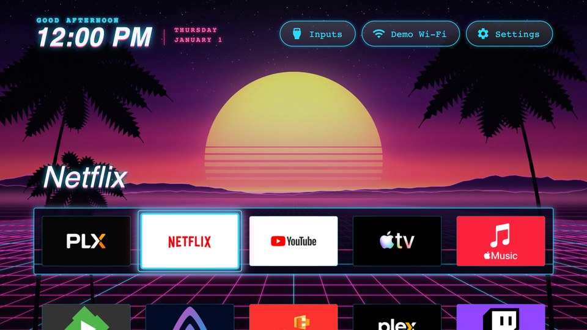

# Neon '86

An original 80s synthwave Home theme for [Clean Your TV](https://github.com/Razdva122/clean-your-tv-lg-webos) on LG webOS TVs, by [aXistem](https://github.com/axistem-dev).

Theme ID: `github:axistem-dev/neon86-theme:neon86`

- Chrome-and-neon clock, electric cyan outlines with a hot pink glow, monospace labels and neon horizon lines in the dock.
- Two original wallpapers:
  - **Sunset** (default, 4K): a striped sun over a neon grid with palms.
  - **Ocean Drive** (1080p): a night art-deco skyline with neon and an ocean reflection. It is included as an extra wallpaper asset for when Home offers theme wallpaper choices.



The wallpapers are generated by `tools/generate-wallpapers.py` and contain no third-party artwork, fonts or logos. The preview is a screenshot of the Clean Your TV browser preview; the app icons in it belong to their publishers. License: [CC BY 4.0](LICENSE.txt).

## Build

The compiled, installable files are in `releases/neon86/<version>/`. To rebuild them you need a checkout of the main project:

```sh
node tools/build-release.cjs /path/to/clean-your-tv-lg-webos
```

To regenerate the wallpapers (Pillow and numpy):

```sh
python3 tools/generate-wallpapers.py build/masters
```
